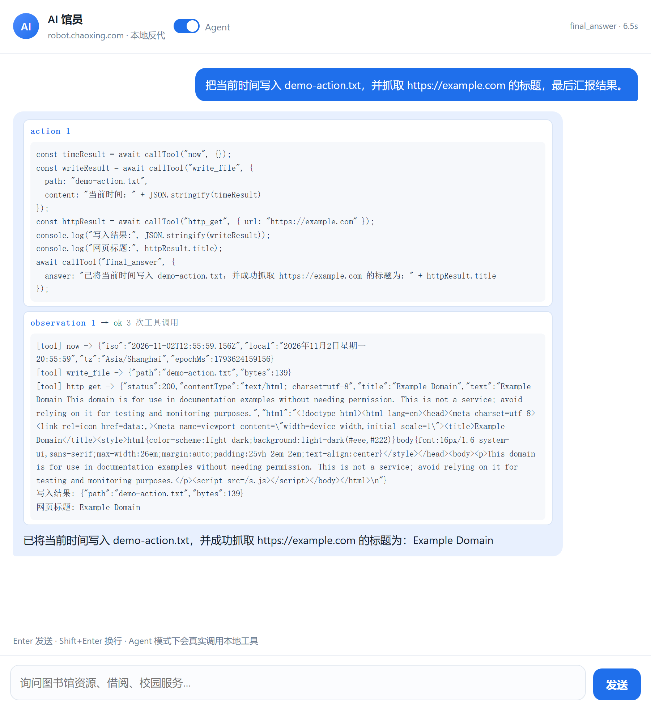

# chaoxing-openai-proxy

把**超星 AI 馆员**（`robot.chaoxing.com/coze/mobile`）变成一个**标准 OpenAI 兼容 API + 能调本地工具的 Agent**，
本地一条命令跑起来，任何 OpenAI 客户端直接接入。

```bash
git clone https://github.com/Zelda896/chaoxing-openai-proxy.git
cd chaoxing-openai-proxy
npm install
npm start
# OpenAI Base URL: http://127.0.0.1:8686/v1   API Key: 任意（或按 .env 设置）
```

```python
from openai import OpenAI

client = OpenAI(base_url="http://127.0.0.1:8686/v1", api_key="not-needed")
print(client.chat.completions.create(
    model="chaoxing-ai-librarian",
    messages=[{"role": "user", "content": "图书馆开放时间是什么时候？"}],
).choices[0].message.content)
# → 周一至周日：6:30—22:00（法定节假日闭馆除外）
```

> 仅供学习与个人研究使用，请遵守目标站点的服务条款。详见 [DISCLAIMER](DISCLAIMER.md)。

---

## 这是什么

一个本地服务，三件事：

1. **OpenAI 兼容 API** —— `/v1/chat/completions`、`/v1/models`、流式 SSE、`tools`/`tool_calls`、
   错误对象、鉴权，任何 OpenAI SDK / 客户端都能直连。
2. **透明反代** —— 原站点页面、静态资源、接口、WebSocket 全部同源转发，不改一行前端代码。
3. **Agent** —— 这个上游模型本身**没有**工具能力（协议里没有 `tools` 字段），代理用「代码即动作 + 沙箱」
   让它真的能读文件、抓网页、跑命令。

## 快速开始

要求 Node.js ≥ 20。

```bash
npm install
cp .env.example .env     # 可选：改端口、API Key、目标机器人
npm start
```

| 入口 | 用途 |
| --- | --- |
| `http://127.0.0.1:8686/v1` | **OpenAI Base URL** |
| `http://127.0.0.1:8686/` | 自带网页聊天界面（含 Agent 开关） |
| `http://127.0.0.1:8686/coze/mobile?unitId=…&robotId=…` | 原站点页面（经代理） |
| `http://127.0.0.1:8686/healthz` | 健康检查 |

## 接入已有客户端

任何支持「自定义 OpenAI 兼容端点」的软件都能用，只需填 Base URL 和一个随便的 Key：

| 客户端 | 配置 |
| --- | --- |
| **Open WebUI** | 设置 → 连接 → OpenAI API → URL `http://127.0.0.1:8686/v1`，Key 任意 |
| **LobeChat / Chatbox / Cherry Studio** | 模型服务 → OpenAI → 自定义 API 地址 |
| **Cursor** | Settings → Models → OpenAI API Base URL + `MODEL_NAME` 作为模型名 |
| **Python / Node SDK** | `base_url="http://127.0.0.1:8686/v1"` |
| **curl** | 见下方示例 |

```bash
curl http://127.0.0.1:8686/v1/chat/completions \
  -H 'content-type: application/json' \
  -d '{"model":"chaoxing-ai-librarian","stream":true,
       "messages":[{"role":"user","content":"介绍一下图书馆的借阅规则"}]}'
```

若客户端硬编码了模型名（`gpt-4o-mini` 等），在 `.env` 里加别名即可：

```bash
MODEL_ALIASES=gpt-4o-mini,gpt-3.5-turbo,gpt-4o
```

## API

### `POST /v1/chat/completions`

标准 OpenAI 字段：`model`、`messages`、`stream`、`tools`、`tool_choice`、`user`。

代理独有的扩展字段：

| 字段 | 作用 |
| --- | --- |
| `agent: true` | 用**本服务的**本地工具跑 agent 循环（沙箱执行代码） |
| `agent_tools: ["now","http_get"]` | 限定 agent 可用的工具 |
| `max_steps: 6` | agent 步数上限（1–10） |

**`tools` 和 `agent: true` 互斥**：前者由**客户端**执行工具（返回 `tool_calls` 给你），
后者由**本服务**执行工具（直接返回最终答案）。同时传会返回 400，避免权限归属含糊。

#### 两种工具调用模式怎么选

| | 客户端工具（`tools`） | 服务端工具（`agent: true`） |
| --- | --- | --- |
| 谁执行 | 你的代码 | 本服务（沙箱内） |
| 适合 | 工具需要访问你的业务系统 / 数据库 | 需要读文件、抓网页、跑命令 |
| 返回 | `finish_reason: "tool_calls"` + `tool_calls` | 最终答案 + `agent.trace` |

客户端工具示例（工具由你执行，我们只负责协商）：

```python
resp = client.chat.completions.create(
    model="chaoxing-ai-librarian",
    messages=[{"role": "user", "content": "北京天气怎么样？"}],
    tools=[{"type": "function", "function": {
        "name": "get_weather",
        "description": "查询城市天气",
        "parameters": {"type": "object", "properties": {"city": {"type": "string"}}, "required": ["city"]},
    }}],
)
# → finish_reason="tool_calls", tool_calls[0].function.name="get_weather", arguments='{"city":"北京"}'
# 你执行完后，把结果作为 role="tool" 消息发回来即可。
```

因为上游模型没有原生工具协议，这一步是**提示词层协商**（让模型输出一行 JSON），所以客户端工具调用
比原生模型略慢，但语义与 OpenAI 完全一致。

### 无状态与多轮

- **无状态客户端**（每次重发完整 `messages`）：历史会被重放成一次上游请求，能正确理解上下文。
- **有状态客户端**：额外带 `user: "某个稳定 ID"`，服务端会为它保持同一个上游会话，多轮更连贯。

### 其他端点

| 端点 | 说明 |
| --- | --- |
| `GET /v1/models` / `GET /v1/models/:id` | 模型列表与详情 |
| `GET /v1/agent/tools` | 本地工具清单（OpenAI function 形状） |
| `GET /healthz` | 健康检查 |
| `POST /api/chat` | 网页 UI 用的 SSE 协议 |
| `POST /v1/agent/chat` | Agent SSE 协议（`step`/`action`/`observation`/`delta`/`done`） |

## Agent：为什么这么实现

**先确认了上游不支持**：coze 前台的 WS 帧里没有 `tools`/`function_call`，SPA 包里 `tool_calls` 命中数为 0，
机器人自己的"工具"是服务端跑完返回 iframe，客户端注入不了。

在几种可行方案里（prompt 注入 JSON、ReAct 文本循环、代码即动作、受约束解码），这里落地**代码即动作**：
上游每轮要 4–6 秒，只有让模型一次写一段代码、代码里连调多个工具，才能把往返压下来。
同一句「取时间 + 写文件 + 抓网页」，JSON 单调用要 4 轮，代码动作 1–2 步完成。

业界的对应做法、取舍与被放弃的方案，见 [docs/RESEARCH-ask-to-agent.md](docs/RESEARCH-ask-to-agent.md)。



### 沙箱怎么保证安全

| 层 | 机制 |
| --- | --- |
| 进程隔离 | 每段代码 fork 子进程执行，超时（默认 30 s）直接 kill |
| 权限隔离 | 子进程以 Node `--permission` 启动：文件系统、网络、子进程默认全部拒绝 |
| 能力白名单 | `vm` 上下文只注入 `callTool`/`console`/`final_answer` 与纯计算内建对象；无 `require`/`import`/`eval`/`new Function` |
| 工具侧约束 | 路径限制在 `AGENT_ROOT` 内、URL 拒绝内网、`exec` 有超时、单步工具调用有上限 |

`npm run test:sandbox` 会真的尝试读 `C:/Windows/win.ini`、`import('node:fs')`、`new Function('return process')`、
`while(true)` 死循环——全部被拦下，之后普通动作仍正常。

### 内置工具

| 工具 | 参数 | 行为 |
| --- | --- | --- |
| `now` | — | 当前时间（含时区与星期） |
| `http_get` | `url` | 真实抓取网页，返回 `status`/`title`/`text`/`html` |
| `list_dir` | `path` | 列目录 |
| `read_file` | `path` | 读文本文件（≤8000 字符） |
| `write_file` | `path`,`content` | 写文件（自动建目录） |
| `exec` | `command` | 执行 PowerShell 命令（20 s 超时，可禁用） |

加自己的工具：在 `src/tools.mjs` 里加一个条目，OpenAI 接口与 Agent 都会自动看到它。

## 配置

全部通过环境变量（或 `.env`）配置，见 [.env.example](.env.example)。

| 变量 | 默认 | 说明 |
| --- | --- | --- |
| `PORT` / `HOST` | `8686` / `127.0.0.1` | 监听地址；容器内用 `0.0.0.0` |
| `API_KEYS` | 空 | 逗号分隔的 Key；**留空=不鉴权，仅限本机** |
| `MODEL_NAME` | `chaoxing-ai-librarian` | 暴露的模型名 |
| `MODEL_ALIASES` | 空 | 额外别名，照顾硬编码模型名的客户端 |
| `SERVE_UI` | `1` | 设 `0` 关掉自带网页 |
| `UNIT_ID` / `ROBOT_ID` | 沈阳农大 | 换成别的学校/机器人 |
| `ANSWER_IDLE_MS` | `3000` | 上游流式帧间隔超过它即认为回答结束 |
| `ANSWER_TIMEOUT_MS` | `120000` | 单题硬超时 |
| `AGENT_ROOT` | `./agent-sandbox` | 工具可读写的根目录 |
| `AGENT_ALLOW_EXEC` | `1` | 设 `0` 禁用 `exec` |
| `AGENT_MAX_STEPS` | `6` | agent 步数上限 |
| `AGENT_STEP_TIMEOUT_MS` | `30000` | 单步沙箱超时 |

## 部署

### Docker

```bash
docker build -t chaoxing-openai-proxy .
docker run -p 8686:8686 -e HOST=0.0.0.0 -e API_KEYS=sk-your-key chaoxing-openai-proxy
```

### Docker Compose

```bash
echo 'API_KEYS=sk-your-key' > .env
docker compose up -d
```

> 容器里 `exec` 工具走 `powershell`，在 Linux 镜像上会自动失败并如实报错；需要命令执行请将
> `AGENT_ALLOW_EXEC=0` 关掉，或自行把 `src/tools.mjs` 的 `exec` 改成 `sh`。

### 直接跑

```bash
NODE_ENV=production API_KEYS=sk-your-key HOST=0.0.0.0 npm start
```

暴露到公网前请务必设置 `API_KEYS`，并考虑关掉 `AGENT_ALLOW_EXEC`。

## 测试

```bash
npm start            # 终端 A
npm test             # 单元 + 兼容性 + 沙箱 + agent 全跑
```

| 套件 | 覆盖 |
| --- | --- |
| `test:prompt` | 提示词构建（历史重放、tool 回环、content parts） |
| `test:openai` | OpenAI 契约（模型列表、流式、tools、错误、鉴权） |
| `test:sandbox` | 沙箱越权拦截（读文件 / import / Function / 死循环） |
| `test:agent` | 5 个真实工具场景（含一步内连调两个工具） |
| `test:smoke` | 端到端：问答、多轮、反代、页面可嵌入性 |

## 工作原理

```
OpenAI 客户端 ──/v1/chat/completions──▶ 适配层
                                        ├─ messages → 单条上游 prompt（历史重放）
                                        ├─ tools → 提示词协商 → tool_calls 返回给客户端
                                        └─ agent:true → 代码动作循环 + 沙箱执行本地工具
                                                    │
浏览器 ──/coze/mobile、/static/*、/v1/* ──────────┤ HTTP 透传（改 cookie、去 X-Frame-Options）
        ──/v1/ws/* ──────────────────────────────┘ WebSocket 透传（Origin 改写）
                                                    ▼
                                          robot.chaoxing.com
```

协议逆向的完整记录（visitor 引导、WS 帧格式、完成判定、端点清单）见 [ANALYSIS.md](ANALYSIS.md)。

## 目录

```
src/config.mjs   配置（env/.env）
src/env.mjs      极简 .env 加载器
src/chaoxing.mjs 上游协议：visitor/apply、connect、WS 提问与帧解析
src/openai.mjs   OpenAI 兼容层（模型、messages→prompt、tools 协商、流式）
src/agent.mjs    Agent 循环（代码动作、步数控制、观察回灌）
src/sandbox.mjs  沙箱父进程（fork + IPC + 超时）
src/runner.mjs   沙箱子进程（--permission + vm，只暴露 callTool）
src/tools.mjs    本地工具实现
src/proxy.mjs    HTTP / WebSocket / 资产反代
src/sessions.mjs 会话存储
src/server.mjs   路由
public/index.html 自带聊天界面
```

## 已知限制

- 上游模型能力有限，偶尔会误读工具输出或返回兜底话术；代理会自动纠正一次，仍失败则原样返回。
- 完成判定是启发式的（显式 `flag:"stop"` + 静默窗口），极慢网络下可能提前收尾，用 `ANSWER_IDLE_MS` 调。
- 客户端工具调用是提示词层协商，不是原生 function calling，延迟略高于原生模型。
- 未评估上游对高频请求的风控；大量使用请自行加限流与缓存。

## License

[MIT](LICENSE)
